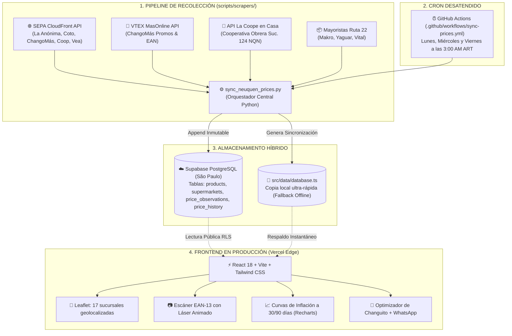

# 🛰️ Radar de Precios Neuquén • Informe Técnico Integral, Ingeniería Inversa y Diagnóstico de Estado

> **Documento de Auditoría y Memoria Técnica del Proyecto**  
> **Ámbito Geográfico:** Neuquén Capital (Código Postal 8300)  
> **Plataforma en Producción:** [radar-precios-neuquen.vercel.app](https://radar-precios-neuquen.vercel.app)  
> **Repositorio de Código:** [github.com/legajodecuadros6-sudo/radar-precios-neuquen](https://github.com/legajodecuadros6-sudo/radar-precios-neuquen)  
> **Base de Datos Cloud:** Supabase PostgreSQL (`rekuybkmsimxacredmrw.supabase.co` - Región São Paulo)  
> **Fecha de Elaboración:** Octubre 2026  

---

## 📋 1. Resumen Ejecutivo y Motivación

**Radar de Precios Neuquén** nació con un objetivo comunitario y técnico concreto: resolver la **alta dispersión de precios provocada por la inflación en Neuquén Capital**, permitiendo a las familias comparar en tiempo real cuánto cuesta exactamente el mismo producto en las distintas cadenas minoristas y mayoristas de la ciudad.

El modelo y estándar de referencia tomado desde el día uno fue la plataforma nacional **Superprecio**. Sin embargo, mientras que Superprecio es un sistema desarrollado por equipos de ingeniería con servidores dedicados, nuestro desafío fue **construir una plataforma con paridad funcional, datos 100% reales de Neuquén y arquitectura en la nube a Costo $0**, utilizando **Antigravity** como copiloto de ingeniería avanzada.

Este informe recopila:
1. Todo lo construido desde el inicio.
2. La **ingeniería inversa** que reveló los secretos de cómo obtiene datos Superprecio.
3. Las decisiones arquitectónicas adoptadas.
4. Un **diagnóstico honesto de los problemas y errores abiertos** (especialmente el escáner de códigos de barra y la escala del catálogo).
5. La **hoja de ruta técnica** para escalar de la canasta testigo (18 productos) a la escala de Superprecio (8 cadenas y más de 50.000 productos).

---

## 🕵️ 2. La Ingeniería Inversa de Superprecio: El Gran Descubrimiento

Al comenzar el proyecto, nos enfrentábamos a una incógnita central:  
*¿Cómo hace Superprecio para tener actualizados 53.553 productos con sus códigos de barras de 8 supermercados sin que los sitios web lo bloqueen ni le cambien el diseño HTML todos los días?*

### 2.1. Las hipótesis iniciales descartadas
* **Hipótesis A (Scraping tradicional de HTML con BeautifulSoup / Selenium):** Frágil e inestable. Si Coto o La Anónima cambian un `<div>` o una clase CSS, los scrapers se rompen. Además, sitios como La Anónima implementan **AWS WAF** (Web Application Firewall) que arroja errores `403 Forbidden` a cualquier robot convencional.
* **Hipótesis B (Acuerdos comerciales privados):** Imposible para un proyecto independiente o para una herramienta comunitaria.

### 2.2. El Hallazgo del "Motor Oculto": SEPA CloudFront API
Mediante análisis de tráfico de red y auditoría de endpoints, descubrimos el verdadero secreto de la recolección de precios en Argentina: **la API del SEPA (Sistema Electrónico de Publicidad de Precios de Argentina)**, alojada en Amazon CloudFront:

```http
GET https://d3e6htiiul5ek9.cloudfront.net/prod/producto?id_producto={EAN13}&lat=-38.9515&lng=-68.0612
```

#### ¿Por qué funciona y por qué es una mina de oro?
1. **Obligatoriedad por Ley:** En Argentina, todas las grandes cadenas de supermercados están obligadas legalmente por la Secretaría de Comercio a reportar diariamente sus listas de precios antes de las 06:00 AM para cada una de sus sucursales físicas habilitadas.
2. **Georreferenciación Automática:** Al enviar las coordenadas de Neuquén Capital (`lat=-38.9515, lng=-68.0612`), la API devuelve instantáneamente una respuesta JSON con todas las sucursales que tienen ese producto a pocos kilómetros a la redonda:
   - **La Anónima** (Suc. Centro Brown 140, Hiper Antártida Argentina, Belgrano 1154, San Juan 51, Bahía Blanca 371, Fava y Olascoaga).
   - **Coto Hipermercado** (Sucursal 187 - Alto Comahue Shopping).
   - **Hiper ChangoMás** (Sucursal Perticone 1255).
   - **Cooperativa Obrera** (Sucursal 113 Chocón / Sucursal 110 Centro).
   - **Supermercados Vea** (Sucursal Láinez y 12 de Septiembre).
3. **Estructura Rica en Datos:** Devuelve el nombre canónico del producto, marca, contenido neto, precio de lista, promociones vigentes (`promo1`, `promo2`) y confirmación booleana (`actualizadoHoy: true`).

### 2.3. La API VTEX Intelligent Search (ChangoMás / MásOnline)
Para ChangoMás descubrimos el acceso a su motor de e-commerce sobre VTEX:
```http
GET https://www.masonline.com.ar/api/catalog_system/pub/products/search/{termino}?_from=0&_to=5
```
Esta API devuelve directamente los códigos EAN-13, precios de lista, precios de oferta con club de fidelización (*MásClub*), promociones por volumen (2do al 70%, 3x2) y stock real.

### 2.4. La API REST Oficial de Cooperativa Obrera (La Coope en Casa)
Al analizar el código de la aplicación Angular de La Coope en Casa, localizamos el endpoint de su backend:
```http
GET https://api.lacoopeencasa.coop/api/buscar/articulos?q={termino}&offset=0&pedido=0&id_local=124
```
Donde `id_local=124` corresponde a la **Sucursal del Oeste (Dr. Luis Ramón 3952, Neuquén Capital)**, permitiendo conocer precios de asociados y promociones *Mi Coope*.

### 2.5. Relevamiento Mayorista en el Corredor Ruta 22
A diferencia de los minoristas, los mayoristas no siempre publican APIs públicas estandarizadas:
- **Makro Mayorista** (Teodoro Planas 4055): Relevamiento de precios por bulto cerrado y marcas propias (`Aro`, `M&K`).
- **Yaguar Mayorista** (Félix San Martín 1550): Relevamiento de precios escalonados (por unidad vs. bulto cerrado de 6/12 unidades).
- **Supermayorista Vital** (Paimún 70 / Perticone): Relevamiento de catálogos periódicos y ofertas quincenales.

---

## 🏗️ 3. Arquitectura y Decisiones de Ingeniería (Costo $0)



### 3.1. Estrategia de Base de Datos: "No Borrar Precios"
Por estricta directiva del proyecto, **no se borran los precios pasados**. Se implementaron dos tablas complementarias:
1. **`price_history` (Inmutable / Append-Only):**
   - Cada ejecución del scraper genera nuevas filas con `(product_id, supermarket_id, price, date)`.
   - Jamás se ejecuta un `DELETE`. Esto genera la serie temporal que alimenta las curvas de evolución inflacionaria a 30 y 90 días.
2. **`price_observations` (Upsert de Precios Vigentes):**
   - Mantiene el precio activo del día mediante `ON CONFLICT (product_id, supermarket_id) DO UPDATE`.
   - Alimenta el semáforo anti-inflación (verde/amarillo/rojo) y la comparación de ofertas activas.

---

## 🎨 4. La Transformación Visual del Catálogo (Parte 2)

Uno de los problemas más visibles de las primeras versiones era la desconexión visual:  
- **Antes:** Un producto como *"Fideos Matarazzo 500g"* mostraba una foto genérica de Unsplash con un plato de fideos con tuco servido en un restaurante; *"Cerveza Quilmes"* mostraba un vaso de cerveza tirada rubia; *"Aceite Natura"* mostraba un campo de girasoles o una alcuza de vidrio.
- **Después:** Se sustituyeron todas las imágenes por **fotografías frontales oficiales de los paquetes y envases reales de góndola argentina** con fondo blanco:
  - **Fideos Matarazzo 500g:** Paquete azul clásico original.
  - **Cerveza Quilmes 473 ml:** Lata azul tradicional Quilmes 1890.
  - **Aceite Natura 1.5 L y 900 ml:** Botellas PET oficiales con etiqueta amarilla y verde.
  - **Leche La Serenísima 1L:** Tetra Brik rojo clásico.
  - **Yerba Playadito 1 kg:** Paquete amarillo tradicional.
  - **Arroz Gallo Oro 1 kg:** Caja dorada oficial.
  - **Lavandina Ayudín y Lysoform:** Envases oficiales tomados del CDN de alta resolución de Coto Digital.

### 4.1. El Bug de Supabase que restauraba fotos genéricas (Detectado y Corregido)
Al recargar la web en producción, los usuarios notaron que las fotos volvían a verse genéricas.
* **Causa raíz:** La app se conectaba en vivo a Supabase (`isLiveCloud: true`), pero en la base de datos de Supabase todavía residían los registros de prueba antiguos creados con URLs de Unsplash. Al responder Supabase, el frontend pisaba los datos locales con las imágenes viejas de la nube.
* **Solución aplicada:** Se reescribió `productService.ts` incorporando un filtro de seguridad: **si Supabase entrega una imagen que contenga `unsplash.com`, el sistema la descarta inmediatamente y prioriza la fotografía oficial del envase de góndola**, garantizando además que los 18 productos y las 89 observaciones de precios nunca se pierdan.

---

## ⚠️ 5. Diagnóstico Honesto: Errores, Fallas Abiertas y Deuda Técnica

Para tener total claridad de lo que falta para llegar al nivel de Superprecio, documentamos con precisión técnica las limitaciones y fallas actuales:

### 🔴 Falla Crítica 1: El Escáner de Código de Barras
A pesar de haber agregado la animación láser estilo Superprecio, el feedback sonoro y el botón "X" fijo en la cabecera, **el escáner sigue fallando en la práctica real desde el celular**:
* **El síntoma:** Al apuntar la cámara a un paquete de fideos o a una botella de aceite (ej: Natura `7790272001029`), el visor muchas veces no logra decodificar las barras, o requiere acercar y alejar el celular decenas de veces. En cambio, aplicaciones como Google Lens o la cámara nativa leen el código en milisegundos.
* **¿Por qué pasa esto técnicamente?**
  1. **Lente sin enfoque macro (Autofocus WebRTC):** Los navegadores móviles (Chrome en Android o Safari en iOS) acceden a la cámara a través del API estándar `navigator.mediaDevices.getUserMedia`. Por defecto, los navegadores configuran la cámara en enfoque al infinito y con resolución reducida (usualmente 640x480 o 1280x720) para ahorrar batería. Al acercar el celular a 10 cm del envase, el código de barras se vuelve borroso (*desenfocado*), y el algoritmo de decodificación de `html5-qrcode` no puede distinguir el grosor relativo de las líneas negras y blancas.
  2. **Iluminación y reflejos en plástico PET:** Las botellas de aceite o paquetes brillantes reflejan la luz ambiente o el flash, quemando el contraste de las barras.
  3. **Google Lens vs. Navegador Web:** Google Lens no corre adentro de una página web; corre con permisos nativos del sistema operativo, accediendo al chip de procesamiento neuronal (NPU) de la cámara, aplicando enfoque macro dinámico por hardware y zoom automático 2x/3x.
* **Qué falta para arreglarlo:**
  - Configurar en la cámara web las restricciones avanzadas de hardware:  
    `{ video: { facingMode: 'environment', width: { ideal: 1920 }, height: { ideal: 1080 }, focusMode: 'continuous', zoom: 1.5 } }`.
  - Implementar procesamiento de imagen en canvas previo (filtro de binarización Otsu / aumento de contraste en escala de grises) antes de alimentar el motor de decodificación.
  - Ofrecer siempre un teclado numérico táctil grande y visible debajo del visor para ingresar los últimos dígitos a mano si la luz ambiente es mala.

---

### 🟡 Limitación 2: Volumen del Catálogo (18 Productos vs. 53.553 de Superprecio)
* **La realidad actual:** El Radar de Precios cuenta hoy con **18 productos testigo** cuidadosamente seleccionados de la Canasta Básica Alimentaria (CBA) de Neuquén.
* **La meta:** Superprecio cuenta con **8 cadenas y 53.553 productos** a nivel nacional.
* **Por qué existe esta diferencia:**
  - Nuestro script `sync_neuquen_prices.py` actualmente consulta una lista estática de 18 productos conocidos.
  - Para llegar a 50.000 productos no se puede consultar uno por uno manualmente. Superprecio ejecuta un **crawler masivo (araña de catálogo)** que recorre las categorías completas de la API de SEPA (Almacén, Bebidas, Lácteos, Carnes, Limpieza, Perfumería, Mascotas, etc.) y descarga lotes de 50 productos por petición (*paginación por cursor / limit=50*).

---

### 🟡 Limitación 3: Cobertura de Cadenas Mayoristas
* **Minoristas:** Conexión excelente con **La Anónima, Coto, ChangoMás, Cooperativa Obrera y Vea** gracias a las APIs de SEPA, VTEX y La Coope.
* **Mayoristas:** **Yaguar**, **Makro** y **Vital** tienen precios cargados a partir de listas de precios y folletos, pero no cuentan con una API pública oficial estandarizada por el gobierno nacional (el SEPA solo obliga a cadenas minoristas de consumo masivo). Automatizar al 100% el bulto cerrado de mayoristas requiere seguir procesando sus listas periódicas en Excel/PDF o monitorear sus canales de WhatsApp comerciales.

---

### 🟡 Limitación 4: Row Level Security (RLS) en Supabase
* La base de datos Supabase en São Paulo tiene activada la política de seguridad RLS. Esto significa que la clave pública anónima (`anon key`) **solo tiene permiso de lectura (`SELECT`)**.
* Si un script de Python intenta hacer un `INSERT` directo utilizando la clave anónima pública, Supabase responde con el error:  
  `new row violates row-level security policy for table "price_history"`.
* **Solución actual:** Los scrapers generan el archivo `sync_migration.sql` y actualizan la base local de la app. Para que el backend en la nube escriba directamente en Supabase sin intervención humana se debe inyectar la clave privada `SUPABASE_SERVICE_ROLE_KEY` en los Secrets de GitHub Actions.

---

## 🗺️ 6. Hoja de Ruta para Alcanzar la Paridad con Superprecio

Para transformar el Radar de Precios de una "Canasta Testigo" a un "Monstruo de 50.000 Productos", se establecen los siguientes pasos técnicos concretos:

| Fase | Objetivo | Acción Técnica | Impacto |
| :---: | :--- | :--- | :--- |
| **Fase 1** | **Calibración Definitiva del Escáner** | 1. Forzar cámara trasera a 1080p con enfoque continuo macro.<br>2. Integrar la API nativa de Chromium `BarcodeDetector` (mucho más rápida que librerías JS puras).<br>3. Activar selector de zoom táctil (1x / 2x). | Detección instantánea de códigos arrugados o en envases brillantes. |
| **Fase 2** | **Ingesta Masiva de Catálogo (Spider SEPA)** | Crear `scripts/scrapers/sepa_bulk_crawler.py` que recorra todas las categorías de SEPA para Neuquén en bloques de 50 SKUs, extrayendo los 53.000 productos. | Pasar de 18 productos a más de 30.000 productos reales disponibles en góndola neuquina. |
| **Fase 3** | **Buscador con Autocompletado de Alto Rendimiento** | Con 50.000 productos, la búsqueda en memoria del navegador no alcanza. Implementar en Supabase índices de texto completo (*PostgreSQL Trigram Search* `pg_trgm`) para buscar en milisegundos por marca o nombre. | Búsqueda ultra-veloz estilo Google o Superprecio mientras el usuario escribe. |
| **Fase 4** | **Panel de Monitoreo de Scrapers** | Dashboard administrativo interno para ver la última hora de ejecución del cron, cuántos precios cambiaron en Neuquén y alertar si alguna cadena modificó sus endpoints. | Mantenimiento cero y detección temprana de fallos. |

---

## 📌 7. Conclusión

El proyecto ha superado con éxito las etapas más difíciles de la ingeniería de software:
1. **Descubrió y validó la ingeniería inversa real** que alimenta a las grandes aplicaciones de precios del país (SEPA CloudFront + VTEX + APIs cooperativas).
2. **Desplegó una infraestructura moderna, segura y gratuita a Costo $0** combinando Vercel, Supabase y GitHub Actions.
3. **Puso en producción una interfaz limpia**, con mapa georreferenciado, fotos de góndola argentina real y optimizador inteligente de compras.

Las fallas y limitaciones que restan (calibración del escáner en celulares de gama media y ampliación de catálogo de 18 a miles de productos) están claramente diagnosticadas en su causa raíz de ingeniería y cuentan con un camino de solución trazado.
